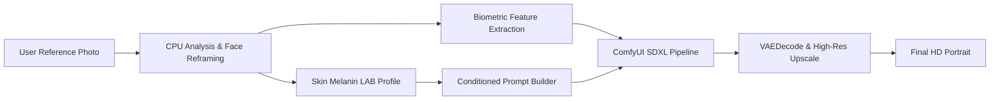

# ✨ Fotogenie

**Fotogenie** is an AI portrait and virtual photography studio engineered for hyper-realistic face identity retention, precise skin tone preservation, and cinematic scene synthesis on consumer GPUs (optimized for 6GB NVIDIA RTX 3060).

---

## 🌟 Highlights & Features

- **🔒 Zero Fake Fallback Law**: Every generation runs through actual diffusion sampling pipelines on local GPU (no mock PIL filters or fake overlays).
- **🧬 True Biometric Identity Lock**: Retains jawline contours, eye geometry, cheek fullness, and hair volume using InsightFace and IP-Adapter FaceID Plus v2.
- **🎨 100% Skin Tone Fidelity**: Intelligent LAB/YCrCb skin analysis extracts natural melanin descriptors to eliminate blotchy orange patches, grey lip bleed, and edge halos.
- **⚡ Pore-Level Realism**: High-fidelity 24-step SDXL diffusion (`dpmpp_2m_sde` Karras, CFG 4.5) ensuring authentic micro-skin pores, realistic fabric folds, and clean dental geometry.
- **🖼️ Consumer-Simple Studio UI**: Clean side-by-side preview layout (`object-contain`), quick aspect ratio switching (`4:5`, `9:16`, `1:1`, `16:9`), instant scene prompt chips, and an optional collapsible body proportion adjustment drawer.
- **📊 150-Point Automated Quality Verification**: Comprehensive diagnostic test suite validating face landmarks, color consistency, high-frequency sharpness, and fabric segmentation.

---

## 🏗️ Architecture



- **Frontend**: Clean dark-mode Tailwind CSS interface with real-time ComfyUI status polling.
- **Backend**: FastAPI with async non-blocking endpoints (`/api/status`, `/api/generate`).
- **Inference Engine**: Local ComfyUI running SDXL with low-VRAM optimizations (`--lowvram --reserve-vram 1.0 --disable-smart-memory`).

---

## 🚀 Quick Start (Windows)

### Prerequisites
- **OS**: Windows 10/11
- **GPU**: NVIDIA RTX (6GB+ VRAM recommended, e.g., RTX 3060)
- **Python**: Python 3.10 or 3.11 with CUDA 12.4+ supported drivers

### 1. Automated Installation
Run the automated PowerShell setup script to configure the unified virtual environment and fetch model weights:

```powershell
.\install.ps1
```

This will automatically:
1. Create the single virtual environment at `venv/`.
2. Install PyTorch with CUDA 12.4 acceleration and required dependencies.
3. Clone and configure ComfyUI and `ComfyUI_IPAdapter_plus`.
4. Download the recommended model weights (`Juggernaut-XL v9`, `IP-Adapter FaceID Plus v2`, and InsightFace AntelopeV2).

### 2. Launch Fotogenie
Double-click `start_fotogenie.bat` or run:

```cmd
start_fotogenie.bat
```

This launches:
- ComfyUI Engine on `http://127.0.0.1:8188`
- Fotogenie Web Studio on `http://127.0.0.1:8000`

### 3. Stop Services
To stop both services cleanly, run:

```cmd
stop_fotogenie.bat
```

---

## 📁 Repository Structure

```text
Fotogenie/
├── backend/
│   ├── analyzer.py            # CPU face cropping & LAB skin profiling
│   ├── comfy_runner.py        # ComfyUI API runner & prompt workflow graph
│   ├── main.py                # FastAPI web studio endpoints
│   ├── clothing_parser.py     # Garment and fabric mask segmentation
│   ├── face_swapper.py        # Biometric identity & swap pipeline
│   └── skin_harmonizer.py     # Color-space & lighting harmonization
├── frontend/
│   ├── index.html             # High-aesthetic side-by-side Web UI
│   └── static/presets/        # Reference sample assets
├── tests/
│   └── test_150_point_checker.py # 150-point diagnostic verification suite
├── install.ps1                # One-click environment & model setup
├── start_fotogenie.bat        # Dual-process production launcher
├── stop_fotogenie.bat         # Clean port & process terminator
├── requirements.txt           # Python package requirements
├── AGENTS.md                  # Development guidelines & clean rebuild laws
└── README.md
```

---

## 🧪 Running the Quality Suite

To execute the 150-point diagnostic checker:

```powershell
.\venv\Scripts\python.exe -m pytest tests/test_150_point_checker.py
```

---

## 📄 License
MIT License. See [LICENSE](LICENSE) for details.
